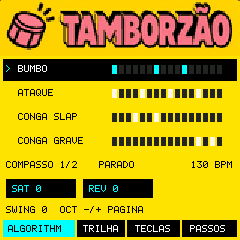
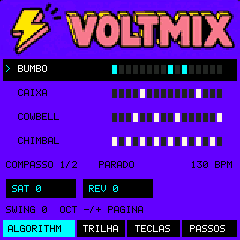
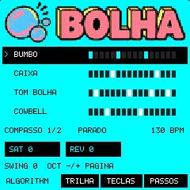
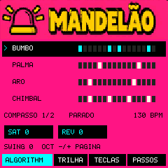

# BAILE by Mulú

A Brazilian beat instrument for the **M-VAVE FM-1**, built around Tamborzão, Voltmix, Beat Bolha and Mandelão. One kit at a time, four visible drum parts, two bars to edit with the keys.

**Experimental development snapshot · 0.3 · hardware installation unresolved.** The portable instrument and native firmware emulation produce audio. Installation from Tessera 3.2.2 stopped during verification; BAILE has not been confirmed running on a physical FM-1. There is no stable firmware release or supported flash procedure yet. See [STATUS.md](STATUS.md).

English · [Português brasileiro](README.pt-BR.md)

## Contents

[Features](#features) · [Screenshots](#screenshots) · [Try it](#your-first-beat-in-60-seconds) · [Controls](#the-controls) · [Install](#install) · [Compatibility](#compatibility) · [Troubleshooting](#troubleshooting) · [Specifications](#specifications) · [Documentation](#documentation) · [Building](#building-and-tests) · [Credits](#credits-and-thanks) · [Licence](#licence)

## What's in 0.3

- BAILE starts with the supplied Tamborzão pattern: **130 BPM, 32 steps, two bars, four samples, 22 hits**.
- PRESETS changes the active kit; ALGORITHM selects a drum part to edit. The keys turn steps on and off.
- K1 Saturator, K2 Reverb, K3 BPM and K4 Swing.
- Each kit keeps its pattern edits during the current session. Tempo, swing and effects stay when changing kits. Restarting restores factory patterns.
- Startup artwork and four kit themes based on the supplied mockups: yellow, violet, cyan and pink.
- Samples, factory patterns and compact LCD artwork are embedded in the application. The intended device package is one `.fwsc`, without a separate sample-bank download.
- Development packaging now uses an FM-1 migration image extent and an explicit writable-storage layout. This did **not** resolve the physical boot-area verification failure; it is not an installation recommendation.

## Screenshots

<table><tr>
<td><br>Tamborzão</td>
<td><br>Voltmix</td>
</tr><tr>
<td><br>Beat Bolha</td>
<td><br>Mandelão</td>
</tr></table>

Captured from native `.fwsc` emulation of BAILE 0.2; the kit visuals are unchanged in 0.3. These are not photographs of the hardware. The display renderer targets **240 × 240 pixels**. Artwork is stored at 160 pixels wide with 32-colour palettes and run-length compression; labels and steps are rendered dynamically.

## Features

### Four kits, one active instrument

| Kit | Parts | Sound source | Status |
| --- | --- | --- | --- |
| Tamborzão | Bumbo, Ataque, Conga slap, Conga grave | Four supplied samples | Pattern and timbres from the supplied Ableton project |
| Voltmix | Bumbo, Caixa, Cowbell, Chimbal | 808 synthesis | Provisional interface-test version |
| Beat Bolha | Bumbo, Caixa, Tom bolha, Cowbell | 808 synthesis | Provisional interface-test version |
| Mandelão | Bumbo, Palma, Aro, Chimbal | 808 synthesis | Provisional interface-test version |

The three provisional kits are sketches, not definitive transcriptions or sample recreations of those styles. Ableton master effects were not reproduced. The embedded Tamborzão bank has 65,036 bytes, identical to the previously tested bank; it was not recompressed for this version.

### Edit while playing

Select a drum part and edit its two-bar pattern. Sixteen keys show one bar at a time. Kit changes are queued while playing and applied immediately when stopped. Selecting the current kit cancels a pending change; the latest queued choice wins.

The browser adapter applies a queued kit before the next bar's audio block. The device SDK uses panel polling to detect the bar change: the first hit may still use the previous kit. Do not infer hardware transition timing from browser tests.

### Session memory

Pattern edits stay in RAM when switching between kits. They are not persistent saves: restarting the instrument or reloading the preview restores the factory patterns. This version has no user-facing project-save workflow.

## Install

**There is currently no verified hardware installation route for BAILE.** Build outputs are experimental developer artifacts, not stable downloads.

In the recorded physical test, M-UPGRADE accepted a three-digit package version, but the installed Tessera 3.2.2 stopped requesting data during verification. Matching-size packages with V15 and V16 boot areas were also refused at the boot-area comparison stage. The application-write phase was not reached in the updater log, and the device subsequently answered as Tessera 3.2.2.

Do not disable those checks or keep flashing guessed boot variants. Keep a complete backup of the firmware you are leaving and follow its documented recovery route. This repository does not contain personal instrument backups or promise a verified rescue procedure. See [STATUS.md](STATUS.md) and [BUILDING.md](BUILDING.md).

## Your first beat in 60 seconds

Once the local preview has been built and served:

1. Open `http://127.0.0.1:8767/preview/` and let the BAILE artwork finish.
2. Press **Tocar** to start Tamborzão and allow browser audio.
3. Select **Conga slap**, then turn some of its steps on or off.
4. Choose **17–32** to edit the second bar.
5. Turn K1 Saturator or K2 Reverb. Change kits with PRESETS.

The browser runs the portable C instrument compiled to WebAssembly. It does not execute the hardware `.fwsc`. The controls are in Portuguese. See [GUIDE.md](GUIDE.md) for the complete current workflow and [BUILDING.md](BUILDING.md) for setup.

## The controls

| FM-1 control | BAILE function |
| --- | --- |
| PRESETS | Choose the active kit |
| ALGORITHM | Select one of the four drum parts |
| 16 white keys | Toggle steps in the visible bar |
| OCT − / OCT + | Show bar 1 / bar 2 |
| SELECT / SEQ | Also change the visible step page |
| K1 | Saturator, 0–100 |
| K2 | Reverb, 0–15 internally; the browser shows a percentage |
| K3 | BPM |
| K4 | Swing |
| PLAY / STOP | Start or stop the pattern |

In the browser: Space starts/stops; Left/Right selects a part; Up/Down changes kits. Keyboard shortcuts do not override focused form controls. See [GUIDE.md](GUIDE.md).

## Compatibility

- **Target:** M-VAVE FM-1, JieLi PI32v2 r3. No other device is supported.
- **Base:** [m-vave/fm1_open](https://github.com/m-vave/fm1_open), FM1 Open V14, commit `4c7496daac04a95ff10d1afdcc8f9ead2dbabc41`.
- **Preview:** portable C host and WebAssembly builds. The WASM build needs WASI SDK 27; the host build supports macOS and Linux.
- **Native emulator:** additional ALNK receive-channel and CPU-instruction support was needed in a local `w0ts/fm1-emulator` build. Stock emulator compatibility is not guaranteed. That emulator fork is not part of this repository.
- **Physical FM-1:** installation unresolved; no successful BAILE hardware boot or physical audio validation.
- **Project formats:** BAILE session state is not a Tessera or SLOOP project. Switching firmware does not convert saved data.

## Troubleshooting

**The browser is silent.** Serve the build on localhost, press Tocar and allow audio. Opening the HTML directly from disk can prevent the audio worklet or WASM from loading. Check the browser's output device and volume.

**My edits disappeared.** Edits are session-only. Reloading or rebooting restores factory patterns.

**M-UPGRADE says “File format error”.** The tested M-UPGRADE parser accepts three digits in the file's outer version field. The native application uses a longer identity. The build creates separate outer wrappers; file acceptance alone is not device compatibility.

**M-UPGRADE says “Verification timeout”.** In the recorded Tessera test this happened before application writing, during package/boot checks. Record the exact code on the physical screen and the previous firmware. Do not infer successful installation from an enabled Update button.

**The emulator stops at `0x12e10` or an unsupported instruction.** The tested SDK uses ALNK RX as its block clock and mixer instructions absent from the original emulator. A local emulator correction allowed execution; this is not proof that the physical firmware works.

**The emulator sound breaks up.** Full CPU emulation was well below real time in the recorded test. Stuttering there does not measure the FM-1's DSP performance.

For other problems, [open an issue](../../issues) with the BAILE commit, target, steps, expected result and actual result. Never attach a complete personal backup to a public issue.

## Specifications

| | Current development snapshot |
| --- | --- |
| Active kits | 1 of 4 |
| Visible drum parts | 4 per kit |
| Factory sequence | 32 steps, two bars, 130 BPM |
| Default kit | Tamborzão |
| Effects | Saturator and reverb |
| Edit retention | RAM for the current session |
| LCD | 240 × 240, RGB565 |
| Embedded LCD artwork | 29,779 bytes |
| Embedded Tamborzão bank | 65,036 bytes |
| Portable render rate | 44,100 Hz |
| Native SDK audio clock | 44,118 Hz nominal; physical validation pending |
| 0.3 USER region | 405,504 bytes at `0x9C000` |
| Hardware release status | Not validated; installation blocked |

## Documentation

- [GUIDE.md](GUIDE.md) — every current control, kit and editing workflow.
- [README.pt-BR.md](README.pt-BR.md) — apresentação e instruções em português.
- [BUILDING.md](BUILDING.md) — dependencies, builds and tests.
- [STATUS.md](STATUS.md) — observed results, failures and remaining work.
- [CHANGELOG.md](CHANGELOG.md) — development history.
- [LICENSING.md](LICENSING.md) — code, SDK, sound and artwork terms.
- [CONTRIBUTING.md](CONTRIBUTING.md) — reporting and contributing.

## Building and tests

```sh
python3 tests/check_repository.py
python3 build.py host
# macOS:
python3 tests/test_instrument.py build/host/baile.dylib
# Linux:
python3 tests/test_instrument.py build/host/baile.so
```

The portable tests cover factory boot, four-kit audio, independent step edits, second-bar keys, retained session edits, pending-kit handling, effects and an embedded bank working with blank writable storage. They do not exercise the board driver or flash hardware. Firmware and browser builds are described in [BUILDING.md](BUILDING.md).

## Contributing

Issues and pull requests are welcome. Keep the active-kit model, current control mapping and the distinction between portable, emulator and hardware evidence. Test the behavior you change and document any device-specific limitation. See [CONTRIBUTING.md](CONTRIBUTING.md).

## Credits and thanks

- **Mulú** — BAILE concept, creative direction, supplied Tamborzão project and visual references.
- **M-VAVE / FM1 Open contributors** — the application base, binary engine SDK, portable engine and device interfaces. Upstream notices are retained.
- **[SLOOP](https://github.com/isod89/sloop-fm1)** — reference for documentation organization. BAILE is based on FM1 Open; this is not a SLOOP firmware fork or a claim of SLOOP's features.
- **[w0ts/fm1-emulator](https://github.com/w0ts/fm1-emulator)** and its upstream contributors — native firmware emulation used during development.
- **[Tessera](https://github.com/Rastapopolix/tessera)** — published migration and backup protocol code used to investigate the blocked installation.
- Synthesizer, codec and runtime contributors listed in [THIRD_PARTY.md](THIRD_PARTY.md).

Implementation and documentation were developed with AI-assisted coding and user feedback. Physical installation failures are recorded, not treated as successful tests.

## Licence

Application code: GPL-3.0-only with the FM1 binary-SDK linking exception; see [LICENSE.md](LICENSE.md). The SDK and third-party components retain their separate terms in [THIRD_PARTY.md](THIRD_PARTY.md). The code licence does not assign an open-content licence to the supplied artwork or sample data; see [LICENSING.md](LICENSING.md).

M-VAVE, FM-1 and other product names belong to their respective owners. No manufacturer or upstream endorsement is implied. No warranty.
