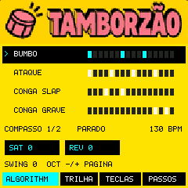
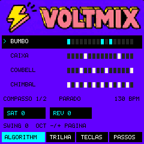
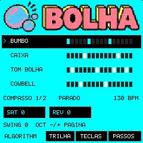
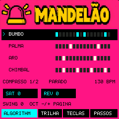

# BAILE by Mulú

Instrumento de beats brasileiros para o **M-VAVE FM-1**, com Tamborzão, Voltmix, Beat Bolha e Mandelão. Um kit ativo por vez, quatro trilhas visíveis e dois compassos para editar nas teclas.

**Versão de desenvolvimento 0.3. A instalação no aparelho ainda não foi concluída.** O instrumento produz áudio no código portátil e na emulação do firmware nativo. O Tessera 3.2.2 recusou a verificação antes da gravação da aplicação. Não há versão estável nem procedimento de instalação física validado. [Estado dos testes](STATUS.md).

[English](README.md) · Português brasileiro

## Conteúdo

[Recursos](#recursos) · [Controles](#controles) · [Primeiro beat](#primeiro-beat) · [Instalação](#instalação) · [Documentação](#documentação) · [Créditos e licenças](#créditos-e-licenças)

## Recursos

- Abre o Tamborzão em **130 BPM**, com 32 passos, dois compassos, quatro samples e 22 eventos do projeto Ableton fornecido.
- PRESETS escolhe o kit e ALGORITHM seleciona o timbre a editar.
- As 16 teclas brancas ativam ou desativam passos. OCT −/+ mostra o primeiro ou o segundo compasso.
- K1 Saturator, K2 Reverb, K3 BPM e K4 Swing.
- Edições ficam guardadas por kit durante a sessão. Reiniciar restaura os patterns de fábrica.
- Abertura BAILE by Mulú e temas amarelo, violeta, ciano e rosa, baseados nos mockups fornecidos.
- O firmware é construído com aplicação, arte, samples e presets embutidos em um único `.fwsc`.

| Kit | Timbres | Estado |
| --- | --- | --- |
| Tamborzão | Bumbo, Ataque, Conga slap e Conga grave | Samples e pattern do projeto fornecido |
| Voltmix | Bumbo, Caixa, Cowbell e Chimbal | Versão provisória com síntese 808 |
| Beat Bolha | Bumbo, Caixa, Tom bolha e Cowbell | Versão provisória com síntese 808 |
| Mandelão | Bumbo, Palma, Aro e Chimbal | Versão provisória com síntese 808 |

Os outros três kits ainda são esboços para testar a interface. Os efeitos de master do Ableton não foram reproduzidos. O banco Tamborzão embutido mantém os mesmos 65.036 bytes da versão anterior.

## Telas

Capturas de emulação nativa do `.fwsc` 0.2, com o mesmo visual dos kits da versão 0.3. Não são fotos do aparelho. A tela é desenhada em **240 × 240 pixels**; a arte compactada tem 160 pixels de largura, 32 cores e compressão. Os nomes e os passos são desenhados pelo código.

## Controles

| Controle | Função |
| --- | --- |
| PRESETS | Escolhe o kit |
| ALGORITHM | Seleciona uma das quatro trilhas |
| Teclas brancas | Editam os 16 passos do compasso visível |
| OCT −/+ | Escolhe o primeiro ou o segundo compasso |
| SELECT / SEQ | Também muda a página de passos |
| K1 | Saturator |
| K2 | Reverb |
| K3 | BPM |
| K4 | Swing |
| PLAY / STOP | Inicia ou para |

No navegador: Espaço toca/para, ←/→ seleciona trilha e ↑/↓ muda o kit. As trocas preservam andamento, swing e efeitos. Durante a reprodução, a seleção fica pendente para a virada do compasso; escolher o kit atual cancela essa seleção. O código do aparelho usa uma detecção por atualização do painel: a primeira batida pode ainda usar o kit anterior. Esse tempo não foi validado no hardware.

## Primeiro beat

Depois de compilar a prévia seguindo [BUILDING.md](BUILDING.md):

1. Abra `http://127.0.0.1:8767/preview/`.
2. Pressione **Tocar** para ouvir o Tamborzão e permitir áudio.
3. Selecione **Conga slap** e edite seus passos.
4. Escolha **17–32** para editar o segundo compasso.
5. Experimente Saturator, Reverb e os outros presets.

A prévia executa o código C compilado para WebAssembly. Ela não executa o `.fwsc` do aparelho. Edições não sobrevivem ao fechamento da página.

## Instalação

**Não há instalação física aprovada nesta versão.** O M-UPGRADE aceitou o formato com versão externa de três dígitos, mas o Tessera 3.2.2 interrompeu a verificação. As variantes com tamanho de imagem corrigido e boot V15/V16 também foram recusadas na comparação do boot. O registro não chegou à fase de gravação da aplicação; o aparelho continuou respondendo como Tessera.

Faça um backup completo antes de qualquer mudança de firmware e siga o procedimento de recuperação do firmware instalado. Não desative as verificações do boot. Os dados pessoais do instrumento não fazem parte deste repositório.

Um arquivo aceito pelo atualizador não significa firmware instalado. O estado atual e as pendências estão em [STATUS.md](STATUS.md).

## Solução de problemas

- **Navegador sem som:** sirva por localhost e pressione Tocar. Confira a saída e o volume do computador.
- **Edições desapareceram:** o armazenamento atual é apenas por sessão; recarregar restaura os patterns de fábrica.
- **Formato inválido no M-UPGRADE:** a versão testada interpreta três dígitos na identificação externa. O build gera uma variante específica, mas a instalação ainda está bloqueada.
- **Verification timeout:** registre o código na tela do próprio FM-1 e o firmware instalado antes da tentativa. Não repita variantes de boot às cegas.
- **Emulador trava em `0x12e10` ou instrução não suportada:** foi necessário acrescentar suporte ao driver de áudio e a instruções do mixer em uma cópia local do emulador.
- **Áudio entrecortado na emulação:** o emulador rodou abaixo do tempo real nesta máquina; isso não mede a capacidade do FM-1 físico.

## Documentação

- [GUIDE.md](GUIDE.md): controles, kits e fluxo atual.
- [BUILDING.md](BUILDING.md): compilação local e testes.
- [STATUS.md](STATUS.md): resultados observados e pendências.
- [CHANGELOG.md](CHANGELOG.md): histórico de desenvolvimento.
- [CONTRIBUTING.md](CONTRIBUTING.md): relatos e contribuições.
- [LICENSING.md](LICENSING.md): condições do código, SDK e assets.

## Créditos e licenças

Conceito e direção criativa de **Mulú**. Base: **M-VAVE FM1 Open V14**, commit `4c7496daac04a95ff10d1afdcc8f9ead2dbabc41`. O [SLOOP](https://github.com/isod89/sloop-fm1) foi usado como referência de organização da documentação; BAILE não é uma derivação do código do SLOOP.

Código da aplicação: GPLv3 com exceção de ligação ao SDK FM1. SDK e componentes mantêm suas licenças específicas. Artes e samples fornecidos não recebem automaticamente a licença do código. Consulte [LICENSE.md](LICENSE.md), [THIRD_PARTY.md](THIRD_PARTY.md) e [LICENSING.md](LICENSING.md).

Desenvolvido com assistência de IA e feedback do usuário. Sem garantia. M-VAVE/FM-1 são marcas de seus titulares; não há endosso implícito.
